# VoltRelay Energy — Battery-Swap Network Analysis

**Analytical report** · January 2024 – June 2025
**Data:** 3,814,402 swap attempts · 150 operating stations · 19,941 riders · 6,500 battery packs · 43,914 tickets
**Prepared by:** Team GTR — Mudit Gupta & Alankrit Kashyap
**Companion notebook:** `VoltRelay_Analysis.ipynb` (runs top-to-bottom; every number and chart here is reproducible)

---

## Executive summary

VoltRelay tripled completed swaps in 18 months — from **3,339 to 10,104 per day** — and grew monthly
revenue from **₹0.62 cr to ₹1.97 cr**. On a fully-loaded contribution basis the network is still
slightly loss-making: **−₹0.68 cr over the window (−2.9% of revenue)**. But the trend is positive.
Contribution per swap improved from **−₹14.51 in January 2024 to +₹2.84 in June 2025**, and the
network has been contribution-positive every month since December 2024.

The improvement came from **price and scale**, not from cost engineering:

| Driver | Jan-2024 | Jun-2025 | Effect on CM/swap |
|---|---:|---:|---:|
| Revenue per swap | ₹59.89 | ₹64.95 | +₹5.06 |
| Energy per swap | ₹22.01 | ₹17.03 | +₹4.98 |
| Station overhead per swap | ₹20.38 | ₹11.68 | +₹8.70 |
| Battery wear per swap | ~₹32.9 | ~₹32.9 | flat |

Battery wear is now **51% of revenue** and is the largest, least-managed cost line.

### Five findings that carry the economics

| # | Finding | Evidence | Value |
|---|---|---|---|
| 1 | **Growth is real but margin-thin** | CM/swap −₹14.51 → +₹2.84; overhead ₹20.4 → ₹11.7 | ₹3–4 cr run-rate |
| 2 | **Failures are thermal and turnaround-driven** | 5.5% normal vs **16.0% on heat-alert days**; 15.7% when cabinet >35 °C; 16.9% when charge >90 min | ₹1.46 cr revenue |
| 3 | **Gen-1 cabinets are the bottleneck** | 48% of swaps, 58% of failures, 92-min charge; 7.2% vs 4.8% failure | ~₹0.3 cr |
| 4 | **Kyron packs are a capital and CX write-off** | 63.7% SOH after 921 cycles vs 80.9% after 1,206 for peers; 1,438 retired | **₹4.79 cr** |
| 5 | **3W and one fleet contract destroy margin** | 3W CM −₹38/swap (−₹1.43 cr); ZipDrop −₹10.33/swap, ₹13/swap give-up | ₹1.43 cr + ₹0.66 cr |

Retention is **stable at 89.1%** (90-day return), with summer dips that track failure spikes. Across
86 city-month cohorts, first-month failure exposure explains **50% of the variation** in month-2
retention (r = −0.71). Usage intensity is the stronger lever: riders doing 21–60 swaps in month 1
return at **96%**, versus **42%** for 1–5 swaps.

---

## 1. Problem understanding

VoltRelay runs a battery-swap network for electric two- and three-wheelers in Bengaluru, Delhi NCR,
Hyderabad, Jaipur, Mumbai and Pune. Riders do not own the battery; they exchange a depleted pack for a
charged one and pay per swap (or their fleet employer is invoiced at a contracted discount).

The company therefore carries three costs that scale with the network — battery capital, energy, and
station fixed cost — while earning a per-swap fee that is increasingly intermediated by fleet
partners. The brief asks one underlying question: **the network is growing, but is it creating value,
and where exactly does value leak?**

Six questions structure the analysis:

1. How did completed swaps, revenue, failure rate and contribution per swap trend over time?
2. Where do service failures come from, and how do they affect rider experience?
3. Which station, equipment and geographic factors drive performance?
4. How does battery health (SOH, cycles, supplier, lot) relate to range and economics?
5. Did the price change, peak/off-peak pilot and partner contracts create or destroy margin?
6. What is the root cause of new-rider churn — and which factors are primary versus secondary?

A 3-minute video was also listed as a deliverable in the brief; it is out of scope here.

---

## 2. Data and methodology

### 2.1 Tables joined

| Table | Grain | Role |
|---|---|---|
| `swap_events` | one attempt | fact table: outcome, price, energy, battery, station |
| `station_hourly_status` | station × hour | charge time, cabinet temperature, stock, outages |
| `stations` | station | generation, location, rent, maintenance, expansion wave |
| `riders` | rider | channel, city, plan, partner, vehicle class |
| `batteries` | pack | supplier, lot, cost, SOH, cycles, retirement |
| `fleet_partners` | contract | terms and discount amendments |
| `support_tickets` | ticket | category, free text, CSAT |
| `city_daily_context` | city × day | temperature, heat alerts, rain, outages |

### 2.2 Data-quality log (quantified before cleaning)

| Issue flagged in the brief | Measured | Treatment |
|---|---:|---|
| Firmware timestamp bug (v3.2.0, 10-Mar to 14-Apr-2025, −5:30) | **139,490 rows** | +5:30 applied before hour/date features |
| Near-duplicate offline-batch records | **580 rows** | dropped when same rider/station/outcome within 120 s |
| Inactive `STN-TST-*` test stations | **62,031 rows** | excluded from all network and station analysis |
| `km_since_last_swap` ≤ 0 or > 300 km | **15,285 rows** | set to missing; range analysis uses cleaned field |
| `soc_out_pct` > 100% | **3,634 rows** | treated as sensor drift, excluded from KPIs |
| `payment_mode` constant / `attempt_seq` constant | 100% | documented limitation: no retry or prepaid split |
| CSAT missing | **65.6% missing** | reported only as context, not a primary CX metric |
| Battery retirement snapshot (June 2025) | 1,438 packs | SOH treated as an end-state, not a time series |

After cleaning: **3,814,402 attempts**, of which **3,586,096 completed (94.01%)** and **228,306 failed
(5.99%)**. The 5h30 timestamp correction matters: without it, evening-peak failure is exaggerated and
some events are matched to the wrong weather day.

### 2.3 Unit-economics model

A fully-loaded contribution margin per completed swap:

```
CM = amount_charged_inr
     − energy_to_recharge_kwh × grid_tariff_inr_kwh
     − purchase_cost_inr ÷ economic life (cycles)
     − (monthly_rent + monthly_maintenance) ÷ completed swaps at that station-month
```

- **Battery life:** 1,250 cycles for 2W 2.1 kWh; 815 for 3W 4.8 kWh. Retired packs are charged at
  their **actual** cycles, so a pack scrapped at 937 cycles carries its true cost.
- **Energy:** delivered kWh at the local tariff. Telemetry implies ~1.53× more grid draw, so this is a
  conservative (understated) energy cost; sensitivity below.
- **Overhead:** all station rent and maintenance is allocated to completions at that station-month.

| Sensitivity | CM/swap |
|---|---:|
| Base case | −1.88 |
| Energy at metered grid kWh (×1.53) | −12.18 |
| Wear life 20% shorter | −8.43 |
| Wear life 20% longer | +3.55 |
| Exclude station rent + maintenance | +11.53 |

The **sign** of recent margin depends on the energy assumption; the **ranking of cost buckets** and
the direction of travel do not. Recommendations are therefore sized on physical levers.

### 2.4 Retention design

- Acquisition = rider's first event.
- Features = first 30 days only.
- Outcome `ret_d90` = any completed swap in days 31–90.
- Riders acquired after 31 March 2025 are excluded (truncated window), which is why May-2025 cohort
  figures that circulate internally should not be quoted.
- Usage and failure are separated by stratification and a logistic model with city, vehicle, partner
  and channel controls.

### 2.5 Limitations

- Observational data; pricing/contract effects use difference-in-differences, not randomisation.
- SOH is end-of-window, so degradation per cycle is a lifetime average.
- `queue_wait_sec` is banded and `attempt_seq` is constant: failure cost is a lower bound.
- Revenue is invoiced, not collected; bad debt is outside the data.
- Tickets are self-selected and categories are agent-assigned (76% agreement with free text).

---

## 3. Key insights

### 3.1 The network has crossed into marginal profitability — through price and scale

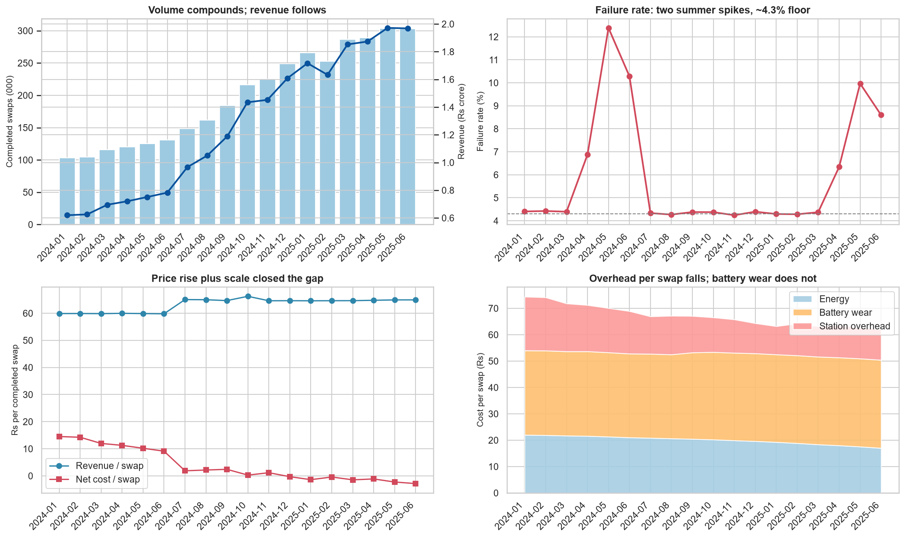

Volume grew every month except February 2025 and reached **10,104 completed swaps/day** in June 2025
(3.0× the January-2024 level). Revenue tracked volume because realised price was flat after July 2024.
The failure rate shows two clear summer spikes (April–June 2024 and April–June 2025) against a ~4.3%
floor.

The margin recovery is visible in the bottom-right panel: **station overhead per swap collapsed from
₹20.38 to ₹11.68** as utilisation filled the launch fleet, and energy per swap fell from ₹22.01 to
₹17.03. Battery wear did not move — it is now **₹32.88 per swap, 51% of revenue**.

**Q1 answer:** the network is growing fast and is now contribution-positive per swap, but the
improvement is a price-plus-utilisation story, not cost engineering. Recent growth is ~95% volume.

### 3.2 Failures are a thermal and turnaround problem, not a software problem

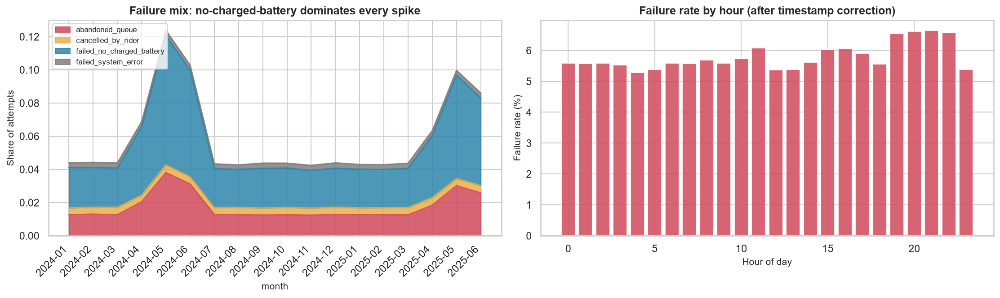

228,306 attempts failed (5.99%). The mix is dominated by **no charged battery** (132,785; 58% of
failures) and **queue abandonment** (67,663; 30%). System errors are only 11,400 (5%).

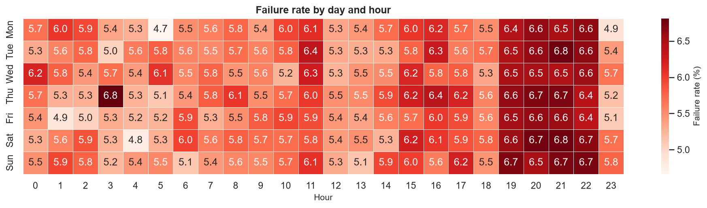

Failure is concentrated in weekday evenings (19:00–22:00: **6.6%** versus 5.5% off-peak) — a real but
secondary effect once the firmware timestamp bug is corrected.

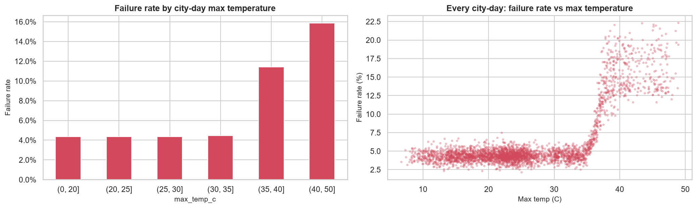

Temperature is the dominant exogenous driver. Daily failure correlates **0.70 with maximum
temperature**. Heat-alert days fail at **16.0%** versus **5.5%** on normal days; below 35 °C the rate is
~4.4%, above 40 °C it is 15.9%.

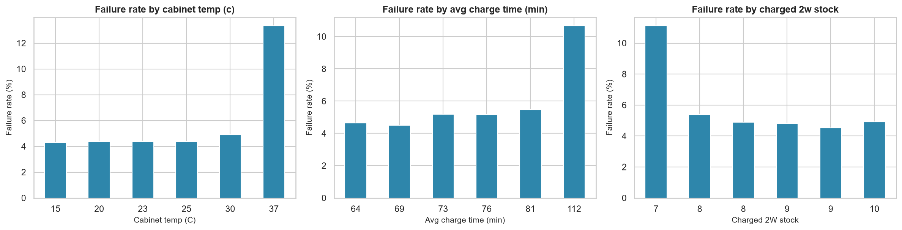

Telemetry makes the mechanism explicit:

| Condition | Failure rate |
|---|---:|
| Cabinet temperature > 35 °C | **15.7%** (vs 5.2% below) |
| Average charge time > 90 min | **16.9%** (vs 5.0% below 80 min) |
| Charged 2W stock, bottom sextile | **11.1%** |
| Charged 2W stock, other five sextiles | 4.5–5.4% |

At city-day level, failure correlates **0.64 with charge time** and **−0.46 with charged stock**.
Heat slows charging → charge time exceeds rider tolerance → no charged pack is available and queues
lengthen → riders abandon. The two summer spikes are the same mechanism.

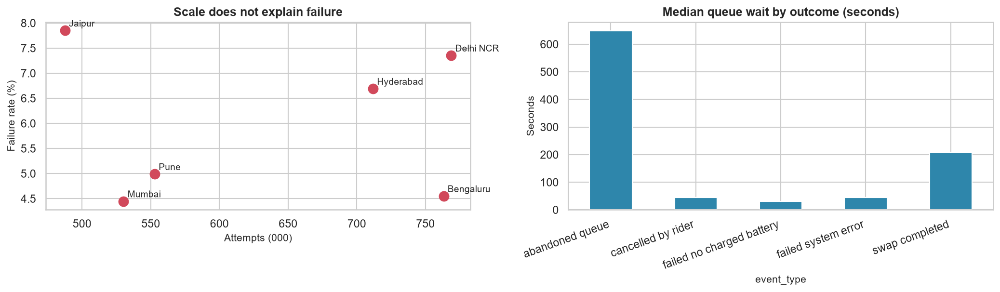

Failure is geographically concentrated: Jaipur **7.9%**, Delhi NCR **7.4%**, Hyderabad **6.7%**,
Pune 5.0%, Bengaluru 4.6%, Mumbai 4.5%. Scale does not explain it — Mumbai and Bengaluru are large and
reliable; Jaipur is small and unreliable.

**Q2 answer:** the 228 k failures represent **₹1.46 cr of foregone revenue** (~6% of billed revenue),
before the retention cost. The cause is heat plus insufficient charged-pack inventory, concentrated
in summer, evenings, Gen-1 cabinets and 3W.

### 3.3 Gen-1 cabinets are the bottleneck; location type is not

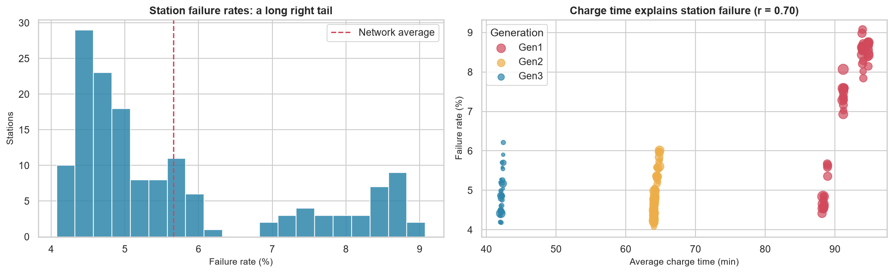

Station failure rates have a long right tail: median **5.0%**, p90 **8.4%**, max **9.1%**. The
**top 20% of stations (30 of 150) generate 41% of failures** while carrying 29% of attempts. Station
failure correlates **0.70 with average charge time**.

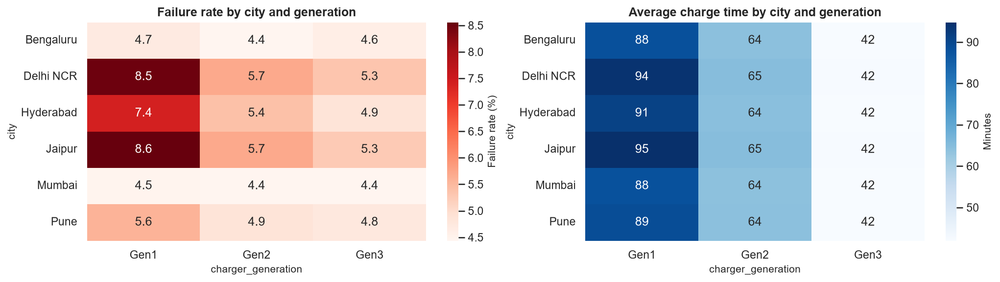

Gen-1 cabinets average **91.8 minutes** per charge versus 64.3 (Gen-2) and 42.2 (Gen-3). They are
**48% of attempts but 58% of failures**. In a station-level regression:

- Generation alone: R² = 0.834, Gen-2 coefficient −1.7 pp, Gen-3 −2.2 pp.
- Adding average charge time: R² = **0.959**, the generation coefficients flip positive, and each
  +10 minutes of charge is associated with **+5.0 pp** failure.

Charge time *is* the mechanism. Location type has no material effect (5.1%–5.9% across all six types).

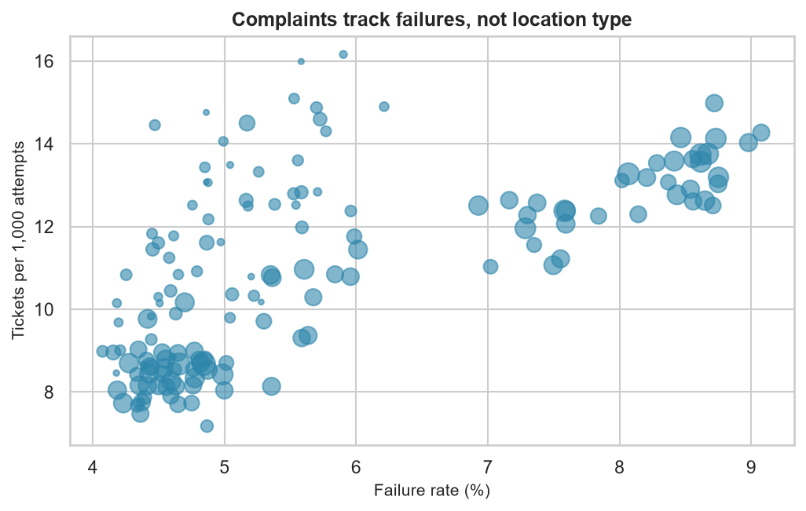

Complaints track failure: **r = 0.63** between station failure rate and tickets per 1,000 attempts
(median 10.8). Riders experience the operational metric directly.

**Q3 answer:** remediate a named list of ~30 Gen-1 stations and fix thermal/charge-time performance.
This is an equipment programme, not a location strategy.

### 3.4 The Kyron battery lots are a ₹4.79 cr write-off and a range problem

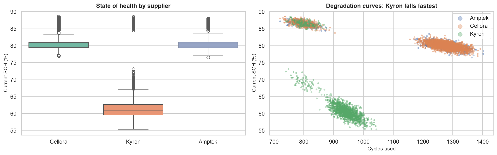

| Supplier | Packs | Mean SOH | Mean cycles | Retired | Degradation /100 cycles |
|---|---:|---:|---:|---:|---:|
| Amptek | 1,307 | 81.0% | 1,202 | 0% | 1.52 pp |
| Cellora | 3,555 | 80.9% | 1,208 | 0% | 1.52 pp |
| **Kyron** | **1,638** | **63.7%** | **921** | **87.8%** | **3.81 pp** |

Kyron packs are **worse despite doing 25% fewer cycles**. Degradation is 2.5× faster. The damage is
lot-specific: **KY-2407/08/09 (1,461 packs) sit at ~61% SOH**, 98–99% retired after ~935 cycles,
commissioned July–September 2024.

**All 1,438 retirements are Kyron**, at **₹4.79 cr** purchase cost — **20% of the ₹24.32 cr fleet asset
base**. Only 200 Kyron packs remain in service.

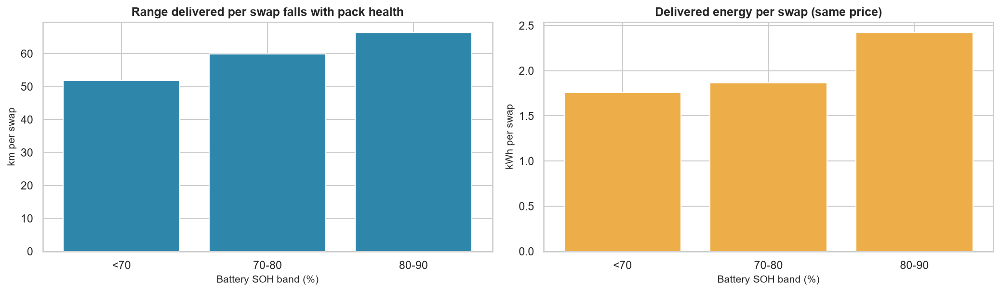

Battery health is directly visible to riders:

| SOH band | km per swap | kWh delivered |
|---|---:|---:|
| < 70% | 51.8 | 1.76 |
| 70–80% | 60.0 | 1.86 |
| 80–90% | 66.3 | 2.42 |

A rider on a degraded pack pays the same price for **14 km less range (−22%)** and **27% less energy**.
This is the physical source of the 6.6 k `low_range` complaints.

**Q4 answer:** the fleet has a supplier-quality problem concentrated in three lots. The commercial fix
is to buy **cycles delivered**, not nameplate kWh: a pack 15% cheaper that delivers 60% of the cycles is
roughly twice as expensive per swap.

### 3.5 Pricing works; 3W and fleet discounts do not

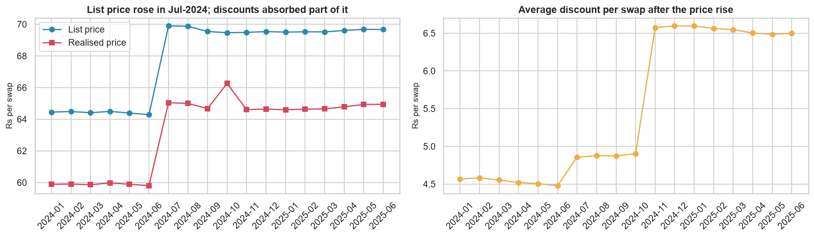

The July-2024 list-price rise (₹64.7 → ₹70.2) stuck: realised price rose **₹59.81 → ₹65.05 (+8.8%)**
with no break in volume. The immediate discount increase was modest (₹4.48 → ₹4.86), but discounts
drifted upward over the following year to ₹6.1 as contract amendments landed.

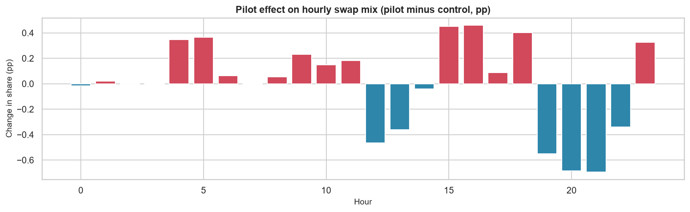

The peak/off-peak pilot (Bengaluru and Pune, October 2024) shifted load:

- Peak-hour share fell **2.75 pp more** in pilot cities than control (53.8% → 51.5% vs 52.4% → 52.8%).
- Realised price in pilot cities ran **₹68.27 vs ₹63.11** in control after launch.

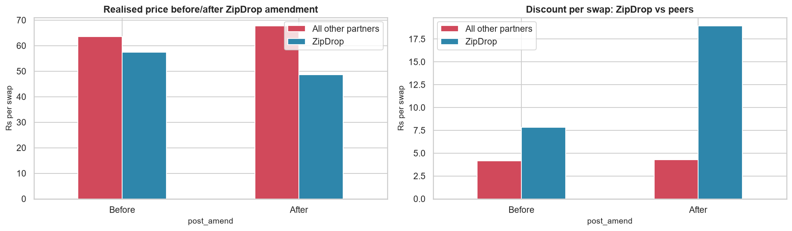

Partner economics are **bimodal**, not clustered:

| Partner | Share of swaps | CM/swap | CM (window) |
|---|---:|---:|---:|
| Independent | 34% | **+₹6.46** | +₹0.79 cr |
| FeastFly | 14% | +₹0.25 | +₹0.01 cr |
| **ZipDrop** | **15%** | **−₹10.33** | **−₹0.57 cr** |
| ParcelNest | 8% | −₹5.09 | −₹0.15 cr |
| **CargoTuk (3W)** | 4% | **−₹38.48** | **−₹0.51 cr** |
| **HaulKing (3W)** | 1% | **−₹37.64** | **−₹0.20 cr** |

ZipDrop's November-2024 amendment raised its contractual discount from 12% to 28%. Its realised price
fell **₹57.48 → ₹48.64** while other partners rose **₹63.53 → ₹67.68** — a **relative give-up of
₹12.99/swap**, about **₹0.66 cr annualised** on post-amendment volume.

Separately, **3W is structurally loss-making**: revenue ₹99.64, energy ₹40.89, battery wear ₹83.36 →
**CM −₹38.32/swap**. 3W is 10.4% of swaps and **−₹1.43 cr** of contribution.

**Q5 answer:** price increases stick and the pilot works modestly, but discount discipline is weak and
3W pricing does not cover battery cost. The leak is two specific segments — 3W and deep-discount
fleets — not the whole partner book.

### 3.6 Retention is stable; failure is an accelerant, usage is the driver

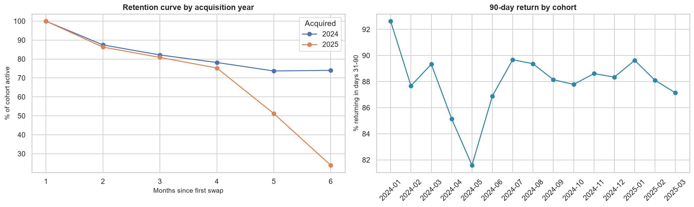

90-day return is **89.1%** overall. Cohort values: 92.6% (Jan-24), 85.2% (Apr-24), **81.6% (May-24)**,
86.9% (Jun-24), 87.1% (Mar-25). There is **no secular collapse**: the dips are seasonal and coincide
with failure spikes, while first-month usage is flat at 23–28 swaps across cohorts.

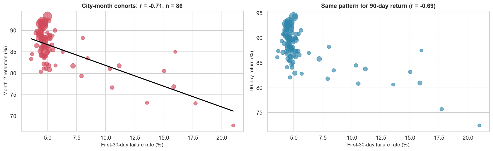

Two drivers, clearly separated:

| First-month swaps | 90-day return | Riders |
|---|---:|---:|
| 1–5 | **42.2%** | 498 |
| 6–20 | **61.8%** | 2,532 |
| 21–60 | **96.0%** | 13,254 |

Conditional on usage, failure still matters: within 21–60 swaps, a first-month failure rate above 10%
cuts return from 96.3% to 94.0%; the >25% failure group returns at **51.6%** overall.

Across **86 city-month cohorts**, first-month failure exposure explains **50% of month-2 retention
variance (r = −0.71, p < 0.001)**. A +1 pp increase in first-month failure is associated with a
**0.97 pp** lower month-2 retention. Cohorts above 10% failure retain **77.3%** in month 2 versus
**87.0%** below 6%.

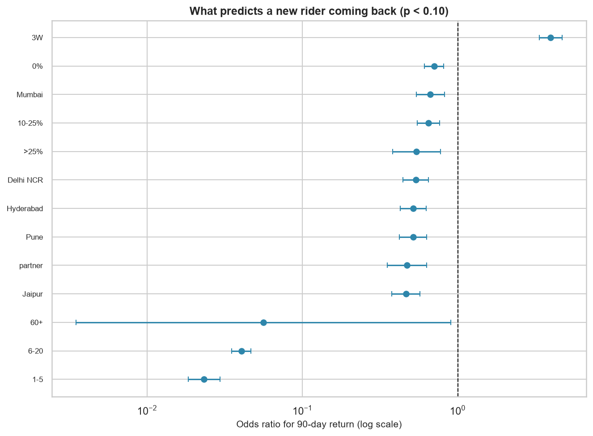

The logistic model (n = 16,286, pseudo-R² = 0.293) confirms the hierarchy:

- **Usage dominates:** 1–5 swaps OR **0.023** and 6–20 swaps OR **0.040** versus 21–60.
- **Failure matters:** 10–25% failure OR **0.65**; >25% OR **0.54**; the 0% group OR 0.70 is also below
  the 0–10% reference because it contains many light users who never had a chance to fail.
- **3W riders are stickier** (OR 3.96, commercial use); partner-onboarded riders less so (OR 0.47).
- **Every city is worse than Bengaluru:** Jaipur OR 0.46, Hyderabad 0.52, Pune 0.52, Delhi 0.54,
  Mumbai 0.67.

**Q6 answer:** retention is not in structural decline. Habit formation is the primary driver; service
failure is a secondary but controllable accelerant. Retention strategy must do both: drive first-month
usage to ~20+ swaps and protect the first 30 days from failure.

### 3.7 Expansion waves and operational anomalies

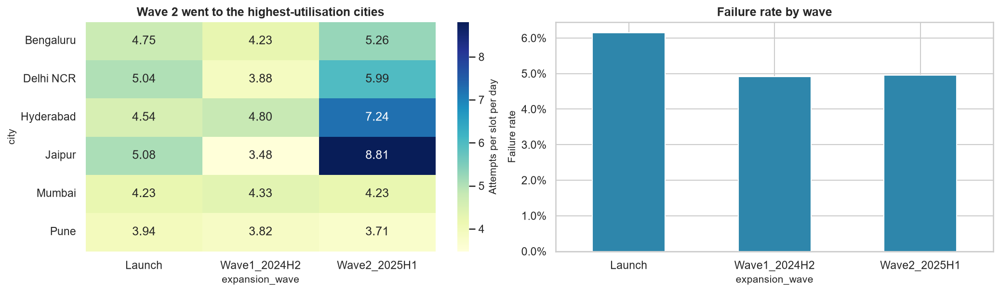

- **Wave 2 (Feb-2025, 30 stations)** was well targeted: **5.83 attempts/slot/day** versus 4.10 for
  Wave 1, with Jaipur at 8.9 and Hyderabad at 7.2.
- **Wave 1 (Aug–Sep 2024, 30 stations)** was more scattered (4.10) and did not measurably relieve
  incumbent stations (failure flat before/after). Site cabinets by measured utilisation and
  charge-time congestion, not city targets.
- **Firmware and sync mode are not associated with failure** (5.9% for both firmware versions); the
  timestamp bug was a logging issue. Connectivity affects reporting latency (45% offline batch at
  poor/fair sites), not reliability.
- Telemetry is 96.9% `ok`; hourly aggregates are directionally reliable.

---

## 4. Business findings

| # | Finding | Quantification | Confidence |
|---|---|---|---:|
| 1 | Network is marginally loss-making but improving | CM −₹0.68 cr in-window; +₹2.84/swap run-rate | High |
| 2 | Recoverable failures at the 30 worst stations | 25,979 attempts · ~₹0.17 cr revenue + retention | High |
| 3 | Gen-1 excess failure versus Gen-2/3 | 43,446 attempts · ~₹0.28 cr revenue | High |
| 4 | Kyron retirement write-off | **₹4.79 cr** one-off; 1,438 packs | High |
| 5 | 3W contribution deficit | **−₹1.43 cr** in-window (CM −₹38/swap) | High |
| 6 | ZipDrop contract leak | **−₹0.57 cr** in-window; ₹12.99/swap give-up | Medium-high |
| 7 | Failed-attempt revenue at risk | ₹1.46 cr in-window | High |
| 8 | Retention exposure to first-month failure | 0.97 pp M2 loss per 1 pp failure; 10 pp gap for >10% cohorts | Medium-high |

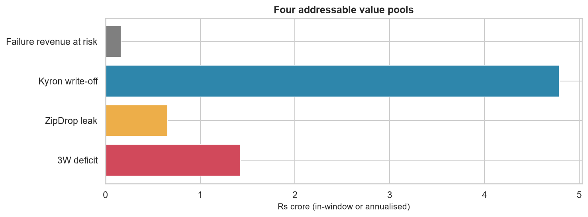

**The addressable pool is ~₹2.3 cr of recurring annual opportunity plus a ₹4.79 cr one-off**, against
an 18-month contribution of **−₹0.68 cr**.

---

## 5. Recommendations

### A. Fix summer reliability (0–90 days)

1. **Retrofit or replace the 30 worst stations** (mostly Gen-1 in Delhi NCR and Jaipur) to the network
   median. Expected: ~26 k fewer failures and ~₹0.17 cr revenue recovered, plus retention benefit.
2. **Deploy thermal management** wherever cabinet temperature exceeds 35 °C for >10% of hours.
3. **Pre-build summer inventory:** +25–30% charged packs in April–June, reallocated from low-utilisation
   sites. The spike is a stock-out.
4. **Make charge time a primary KPI**, alerting at 85 minutes.

*Owner:* Network Operations + Hardware · *KPI:* network failure ≤4.8% in Jul–Sep; Gen-1 ≤5.5%; p90
charge time ≤80 min.

### B. Stop the battery value leak (0–6 months)

5. **Claim on Kyron lots KY-2407/08/09** — ₹4.79 cr retired at ~61% SOH after ~935 cycles.
6. **Quarantine the remaining 200 Kyron packs** from range-sensitive riders; publish SOH at station.
7. **Contract on ₹/cycle** (≥1,200 cycles at ≥80% SOH) with lot-level traceability.

*Owner:* Procurement + Finance · *KPI:* ₹/cycle by supplier; % fleet below 70% SOH; warranty recovery.

### C. Re-price unprofitable segments (0–6 months)

8. **3W: +₹35/swap or per-kWh battery pass-through.** Cap 3W expansion until unit economics are fixed.
9. **Fleet floor of variable cost + ₹8/swap, discount cap 15%.** Renegotiate ZipDrop first
   (~₹13/swap give-up, ₹0.57 cr in-window).
10. **Roll out peak/off-peak pricing nationally**, paired with summer capacity planning.

*Owner:* Commercial + Pricing · *KPI:* 3W CM ≥ −₹5/swap; fleet discount ≤15%; peak share −3 pp.

### D. Engineer retention (1–2 quarters)

11. **Drive 20+ first-month swaps** via commute bundles and employer/route partnerships. This is the
    difference between 42% and 96% 90-day return.
12. **Guarantee the first month:** proactive credit for failed attempts in days 1–30 and an alternative
    station SMS when a pack is unavailable.
13. **Focus on Jaipur and Delhi NCR**, where failure and churn are both highest.

*Owner:* Growth + CX · *KPI:* % new riders reaching 20 swaps in month 1; M2 retention by city.

### E. Fix measurement gaps (next data release)

14. Capture **attempt/retry linkage**, **prepaid vs invoiced** revenue, **true queue timestamps**, and
    **monthly SOH snapshots per pack**. These four changes would sharpen every analysis here.

### Budget decision

| Option | Cost | Expected effect | Score |
|---|---|---|---:|
| Thermal retrofit + Gen-1 replacement (top 30) | ₹2.4–3.0 cr capex | 26 k fewer failures; ₹0.17 cr revenue + retention | **5** |
| National peak/off-peak pricing | Low | +₹2–5/swap; pilot moved 2.75 pp of load | 4 |
| More batteries (+10% 2W fleet) | ₹2.4 cr capex | Alleviates stock-outs; wear already the largest cost | 3 |
| More stations (Wave 3) | ₹2.8 lakh/site/year | Only where utilisation >6 attempts/slot/day | 3 |
| Exclusive with largest fleet partner | Negative margin | Deepens the ₹13/swap give-up | 1 |

**Recommendation:** fund reliability capex first, use pricing as the low-cost complement, and do not
buy growth with exclusivity until the 3W and discount economics are fixed.

---

## 6. Conclusion

VoltRelay has genuine product-market fit: volume tripled, price increases stuck, and the network now
earns positive contribution per swap. But the business is running on a treadmill of thermal failures,
an under-performing battery vendor, and two loss-making segments. The leaks are concentrated and
measurable — 30 stations, one supplier, one vehicle class, one contract account — which makes them
fixable with targeted capital and contract discipline rather than a network-wide transformation.

---

## Appendix — metric definitions

| Metric | Definition |
|---|---|
| Failure rate | failed attempts ÷ all attempts |
| Completed swap | `event_type == 'swap_completed'` |
| Contribution margin | revenue − energy − battery wear − allocated station overhead |
| Battery wear | purchase cost ÷ economic-life cycles (actual cycles for retired packs) |
| M1 / M2 / M3 retention | any completed swap in days 0–30 / 31–60 / 61–90 |
| `ret_d90` | any completed swap in days 31–90 |
| Peak hours (pilot) | 12:00–14:00 and 19:00–22:00 |
| Cohort | calendar month of a rider's first event |
| DiD | difference-in-differences versus control cities |

### Reproducibility

1. Put the eight CSVs in the same folder as the notebook.
2. Run all cells top-to-bottom (`Kernel → Restart & Run All`).
3. Figures are written to `figures/` and match the images in this report.
4. Report rendered from `VoltRelay_Analysis_Report.md`; `VoltRelay_Analysis_Report.html` is a
   self-contained copy with embedded images.
